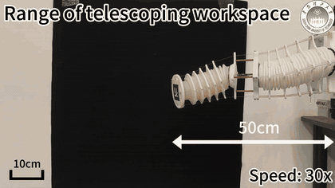
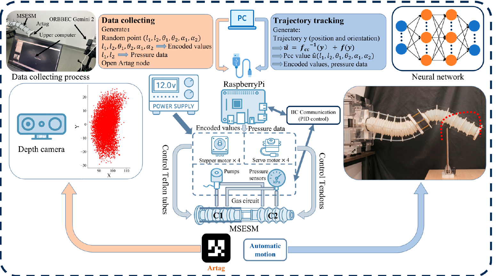
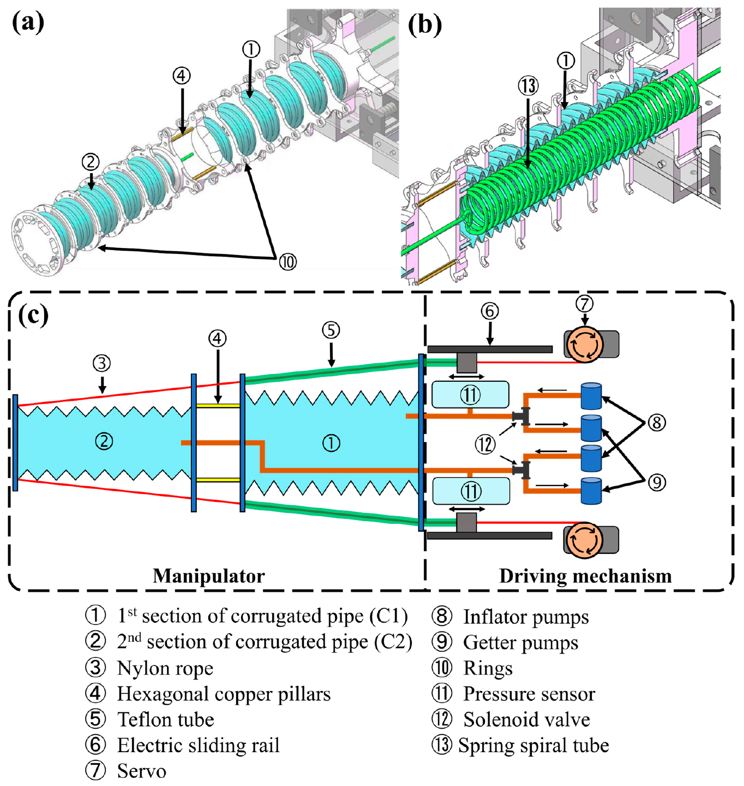

# Continuum_Manipulator

Code, data and CAD for **"Multi-Segment Extendable Soft Manipulator Driven by a Pneumatic–Tendon Coupling Mechanism"**, *Biomimetics* 2025, 10(10), 643. [[Paper]](https://doi.org/10.3390/biomimetics10100643)

<p align="center">
  
</p>

MSESM is a two-segment soft manipulator built from industrial bellows and 3D-printed parts. Each segment can bend and extend:

- **Bending of segment C1**: four Teflon tubes pushed and pulled by four linear slides driven by closed-loop stepper motors (Emm V5).
- **Bending of segment C2**: four nylon tendons reeled by four Feetech STS3215 servos on winders. The tendons run through the Teflon tubes of C1 so the two segments don't interfere.
- **Extension**: each bellows segment has its own pneumatic circuit (inflation pump, deflation pump, solenoid valves, BMP280 pressure sensor), closed-loop controlled by a Raspberry Pi.

Control combines a **piecewise constant curvature (PCC) model** with a **neural network**. The network maps a desired end-effector pose to actuator commands and PCC parameters (L, α, θ), and the PCC model turns those parameters into tendon lengths. In the paper, this hybrid controller reduced average tracking error by 60.43% compared with a pure neural-network controller.

## System overview

<p align="center">
  
</p>

| Component | Hardware | Code |
|---|---|---|
| Pose sensing | ORBBEC Gemini 2 camera + AR tag on the end effector, `ar_track_alvar` (ROS 1, Ubuntu 20.04) | `ros/` |
| C1 bending | 4 × Emm V5 stepper-driven linear slides, UART via a CH9344 USB-to-serial board | `deploy/` |
| C2 bending | 4 × Feetech STS3215 servos (SCServo SDK, 1 Mbps) | `deploy/` |
| Extension | Pumps, solenoid valves and BMP280 sensors, Raspberry Pi with PID | `raspberry_pi/` |
| Learning | MLP (Keras) exported to ONNX, `StandardScaler` for inputs and outputs | `learning/`, `deploy/models/` |

## Repository layout

```
├── data/
│   ├── Training_Data.csv           # 9,463 samples: actuator states ↔ AR-tag pose (see data/README.md)
│   └── README.md                   # column descriptions
├── learning/
│   └── train_mlp.py                # trains the MLP mapping pose → actuator commands
├── deploy/
│   ├── collect_and_track.py        # main PC script: keyboard teleop, data recording, model-based trajectory tracking
│   ├── teleop_servo_stepper.py     # earlier teleop for servos + stepper slides
│   ├── teleop_servo.py             # servo-only teleop
│   └── models/                     # deployed ONNX model and fitted scalers
├── ros/
│   ├── ar_pose_publisher.py        # /ar_pose_marker → Euler angles → /marker_pose_info
│   └── pose_info_subscriber.py     # simple listener for /marker_pose_info
├── raspberry_pi/
│   ├── pressure_controller.py      # receives target pressure over UART, PID-controls pumps and valves
│   └── pump_valve_test.py          # bench test for pumps, valves and PID
├── hardware/
│   ├── print_parts/                # STL files of the 3D-printed parts
│   └── solidworks/                 # SolidWorks parts and full-machine assembly
└── docs/media/                     # figures and demo animation
```

## How it works

1. **Data collection** (`deploy/collect_and_track.py`). Drive the servos and slides from the keyboard, and set chamber pressures from the terminal. Each time you record, the script appends the actuator state and the latest AR-tag pose (subscribed from `/ar_pose_marker`) to a CSV file.
2. **Training** (`learning/train_mlp.py`). Quaternions are converted to roll/pitch/yaw. Inputs are `[x, y, z, roll, pitch, yaw]`, and the outputs are standardized. The network is a 6 → 256 → 256 → N MLP trained with MSE loss and early stopping.
3. **Tracking** (`start()` in `deploy/collect_and_track.py`). For each waypoint (a circle by default), the ONNX model predicts servo positions, chamber pressure and PCC parameters (L, α, θ). `calculate_lengths()` converts these into the four tendon lengths, and from there into stepper pulses. Commands are then sent to the servos, the slides and, over UART, to the Raspberry Pi.

Tendon length for tendon *j* under the constant-curvature assumption, with radius *r*:

```
β_j = α + (j − 1)·π/2
l_j = 2·(L/θ)·sin(θ/2) − 2·r·cos(β_j)·sin(θ/2)
```

## Quick start

```bash
pip install -r requirements.txt
cd learning && python train_mlp.py          # retrain the MLP from data/Training_Data.csv
```

To run on the robot, use the PC with ROS Noetic, `ar_track_alvar` and the Feetech `scservo_sdk` on the Python path:

```bash
roslaunch <your camera + ar_track_alvar launch file>     # publishes /ar_pose_marker
cd deploy && python3 collect_and_track.py                # keys: w/s/a/d servos, e–p slides, z set pressure, f run trajectory, q home & quit
```

On the Raspberry Pi, run `raspberry_pi/pressure_controller.py`.

Serial device names (`/dev/ttyUSB0`, `/dev/ttyCH9344USB*`), servo home positions and the AR-tag workspace are specific to our setup. Adjust them at the top of each script.

## Notes and known limitations

This repository archives the code as it was used during the project. Comments are partly in Chinese.

- `learning/train_mlp.py` is the **pure-network** version. It predicts 10 actuator values (4 servos, 4 steppers, 2 pressures). The deployed model in `deploy/models/` is the **hybrid** version. It predicts 8 values: `Servo1–4, Pressure_2, L, alpha, theta`, which you can check against the scaler dimensions. Its training script is not included. The required columns (`L`, `alpha`, `theta`) are in `data/Training_Data.csv`.
- In `start()`, `new_data[0] = x` / `new_data[2] = y` index a 1 × 6 array by row. This should be `new_data[0][0]` / `new_data[0][2]`. Fix this before running the trajectory.
- The Raspberry Pi scripts import a BMP280 helper module (`atmosphere_function1`) that is not included. Any BMP280 driver exposing `BMP280(...)` and `read_pressure()` will work.
- Vendor SDKs (Feetech SCServo, CH9344 driver, Emm V5 tools) are not redistributed here. Get them from the manufacturers.

## Hardware files

<p align="center">
  
</p>

| Folder | Content |
|---|---|
| `hardware/print_parts/` | Printable parts: segment rings (大/中/小 = large/medium/small), winder housing and drum (绕线器外壳, 绕线盘), pulleys (滑轮), profile mounts (铝型材底座), screw sleeve (螺丝套筒) and AR-tag end block (末端识别块) |
| `hardware/solidworks/` | Full-machine assembly (整机v2装配体), winder assembly (绕线器装配体), printed bellows segments (打印波纹管), frame plates, servo and pump models |

## Citation

```bibtex
@article{yang2025msesm,
  title   = {Multi-Segment Extendable Soft Manipulator Driven by a Pneumatic--Tendon Coupling Mechanism},
  author  = {Yang, Hongxi and Zeng, Yufeng and Zhong, Zeyu and Chen, Zhiyan and Zhou, Junxi and Ling, Zhicheng and Chen, Ye and Li, Yunquan},
  journal = {Biomimetics},
  volume  = {10},
  number  = {10},
  pages   = {643},
  year    = {2025},
  doi     = {10.3390/biomimetics10100643}
}
```

## Acknowledgements

This work was carried out at South China University of Technology under the supervision of Prof. Yunquan Li, supported by NSFC project No. 52405019. Hongxi Yang and Yufeng Zeng contributed equally.

## License

Code is released under the MIT License (see `LICENSE`). Figures in `docs/media/` are taken from the open-access paper (© the authors, CC BY).
