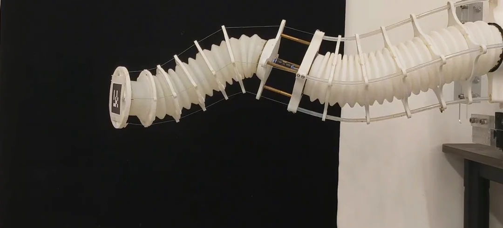
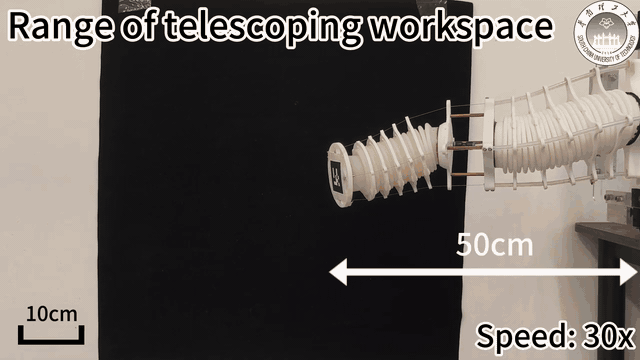
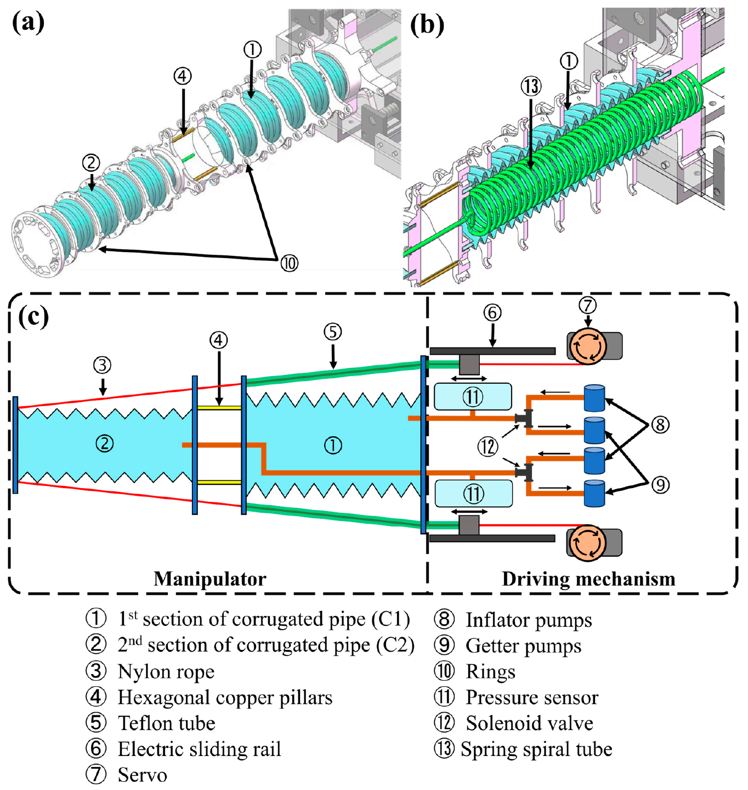
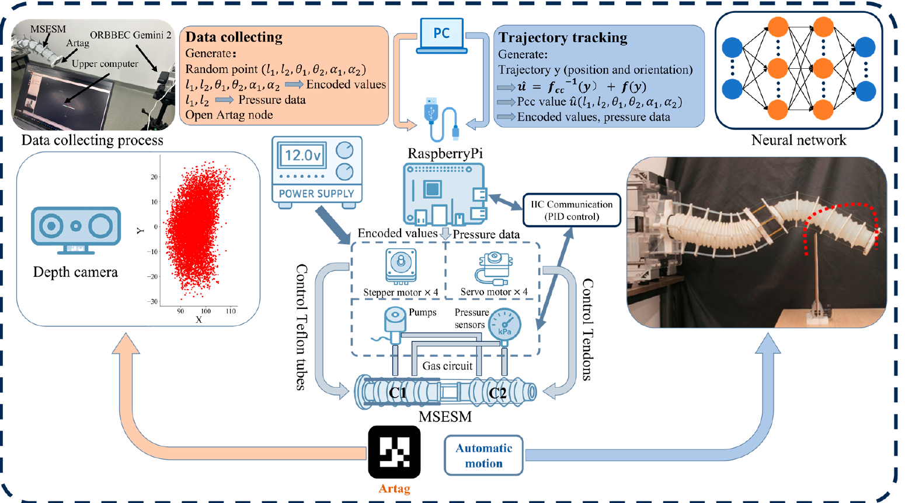
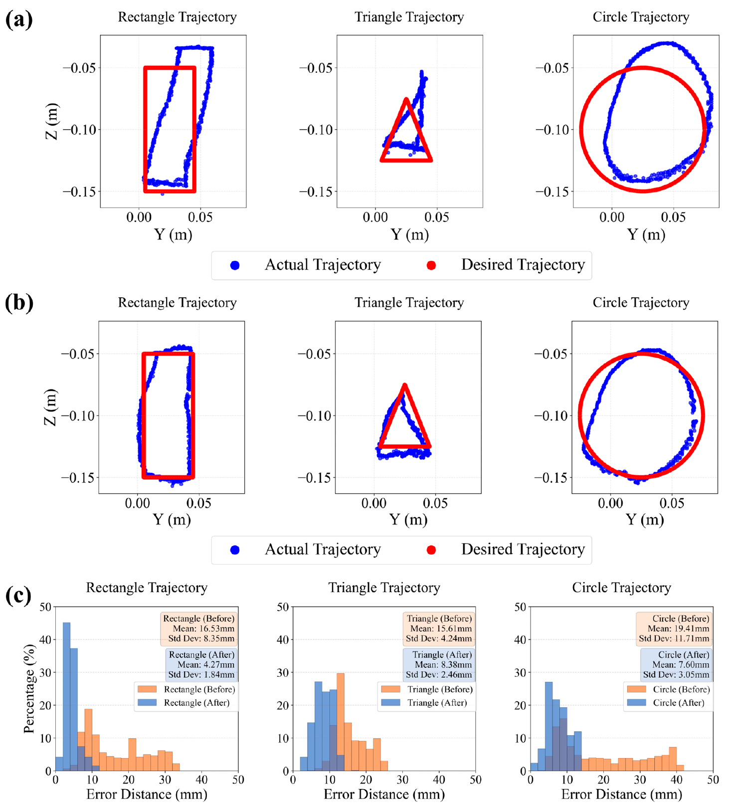

<div align="center">



<br />

**English** · [简体中文](README.zh-CN.md)


</div>

Two bellows segments, each bent by its own set of four tendons and stretched by air. A neural network built on top of a constant-curvature model turns a target pose into motor and pressure commands. Compared with a network alone, this cuts tracking error by about 60%.



## How it works



- **Teflon tubes (C1)**: four stepper-driven linear slides push and pull Teflon tubes to bend the first segment.
- **Tendons (C2)**: four servos reel in nylon tendons. The tendons run through C1's tubes, so the second segment bends independently.
- **Air**: each bellows has its own inflate and deflate pumps, valves and BMP280 sensor. A Raspberry Pi PID sets its length, with up to 156.85% extension.
- **PCC + network**: the network predicts servo targets, pressure and constant-curvature parameters (L, α, θ). The PCC model then converts these into tendon lengths.



## Results



<sub>(a) Network only · (b) PCC + network · (c) error distribution. Mean error 16.5 → 4.3 mm (rectangle), 15.6 → 8.4 mm (triangle), 19.4 → 7.6 mm (circle). Figure from the paper.</sub>

## Repository

```text
learning/        train_mlp.py, MLP from end-effector pose to actuator commands
deploy/          collect_and_track.py (teleop · data recording · trajectory tracking), teleop scripts
deploy/models/   deployed ONNX model + input/output scalers
ros/             AR-tag pose publisher / listener (ar_track_alvar)
raspberry_pi/    pump, valve and pressure PID control
data/            Training_Data.csv, 9,463 samples (column guide in data/README.md)
hardware/        print_parts/ STL · solidworks/ parts & full assembly
```

## Quick start

- **Train**: `pip install -r requirements.txt`, then `python learning/train_mlp.py`.
- **Run**: on Ubuntu 20.04 + ROS Noetic, with `ar_track_alvar` publishing `/ar_pose_marker` and the Feetech `scservo_sdk` installed, run `cd deploy && python3 collect_and_track.py`. Keys: `w/s/a/d` servos · `e`–`p` slides · `z` pressure · `f` trajectory · `q` home.
- **Air**: run [`raspberry_pi/pressure_controller.py`](raspberry_pi/pressure_controller.py) on the Pi.
- **Print**: STL files are in [`hardware/print_parts/`](hardware/print_parts/), and the full assembly is in [`hardware/solidworks/`](hardware/solidworks/).

This is research code, archived as it was used. Serial ports and servo home positions are specific to our setup.

<details>
<summary>Known gaps</summary>

- `train_mlp.py` is the network-only version (10 outputs). The deployed hybrid model predicts `Servo1–4, Pressure_2, L, alpha, theta`; its training script is not included, but those columns are in the dataset.
- In `collect_and_track.py` → `start()`, `new_data[0] = x` / `new_data[2] = y` should be `new_data[0][0]` / `new_data[0][2]`.
- The Pi scripts import a BMP280 helper (`atmosphere_function1`) that is not included. Any driver with `BMP280(...)` and `read_pressure()` will work.
- Vendor SDKs (Feetech SCServo, CH9344, Emm V5) are not redistributed.
</details>

## About

By **Hongxi Yang** and **Yufeng Zeng** (equal contribution), South China University of Technology · Advisor: Prof. Yunquan Li · NSFC No. 52405019.
Published in *Biomimetics* 2025, 10(10), 643: [Multi-Segment Extendable Soft Manipulator Driven by a Pneumatic–Tendon Coupling Mechanism](https://doi.org/10.3390/biomimetics10100643).

<details>
<summary>BibTeX</summary>

```bibtex
@article{yang2025msesm,
  title   = {Multi-Segment Extendable Soft Manipulator Driven by a Pneumatic--Tendon Coupling Mechanism},
  author  = {Yang, Hongxi and Zeng, Yufeng and Zhong, Zeyu and Chen, Zhiyan and Zhou, Junxi and Ling, Zhicheng and Chen, Ye and Li, Yunquan},
  journal = {Biomimetics},
  volume  = {10},
  number  = {10},
  pages   = {643},
  year    = {2025},
  doi     = {10.3390/biomimetics10100643}
}
```
</details>

Code under the MIT License. Figures are from the open-access paper (CC BY).
