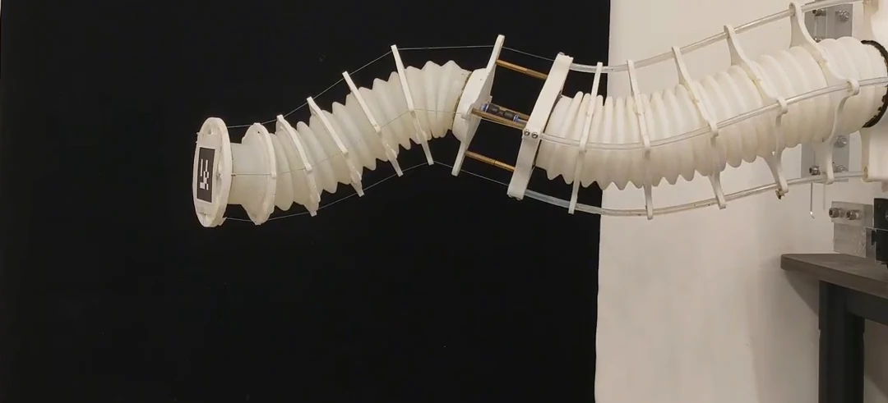
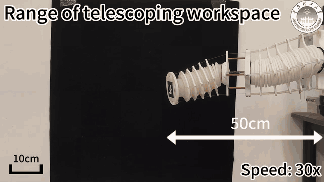
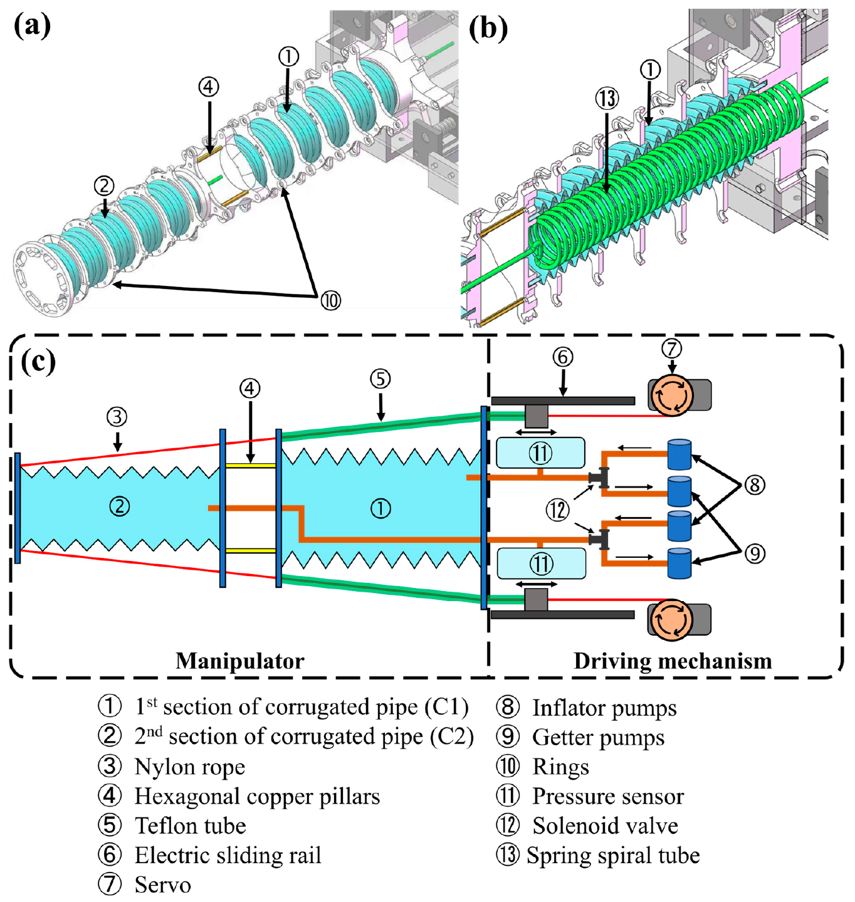
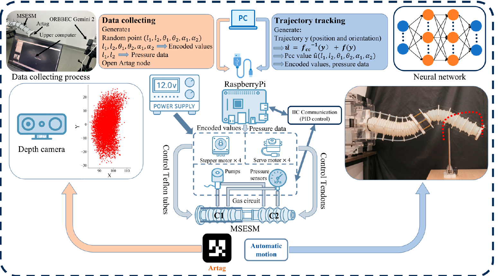
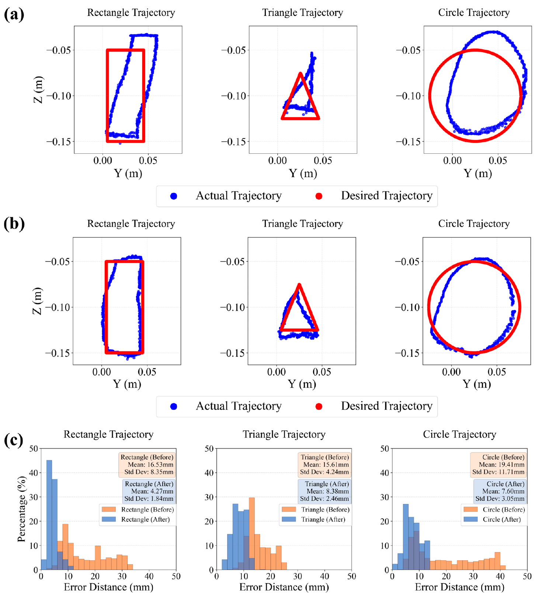

<div align="center">



<br />

[English](README.md) · **简体中文**


</div>

两段波纹管，每段由各自的四根腱驱动弯曲，靠气压伸长。在常曲率模型的基础上叠加神经网络，把目标位姿换算成电机和气压指令。和单纯使用神经网络相比，跟踪误差降低了约 60%。



## 工作原理



- **特氟龙管（C1）**：四个步进电机驱动的直线滑轨推拉特氟龙管，使第一段弯曲。
- **腱绳（C2）**：四个舵机收放尼龙腱绳。腱绳穿过 C1 的特氟龙管，所以第二段可以独立弯曲。
- **气压**：每段波纹管都有独立的充气泵、抽气泵、电磁阀和 BMP280 气压传感器，由树莓派做 PID 控制长度，最大伸长率为 156.85%。
- **PCC + 神经网络**：网络预测舵机目标、气压和常曲率参数（L、α、θ），再由 PCC 模型换算成腱长。



## 实验结果



<sub>(a) 仅神经网络 · (b) PCC + 神经网络 · (c) 误差分布。平均误差：矩形 16.5 → 4.3 mm，三角形 15.6 → 8.4 mm，圆形 19.4 → 7.6 mm。图片来自论文。</sub>

## 仓库结构

```text
learning/        train_mlp.py：从末端位姿到执行器指令的 MLP
deploy/          collect_and_track.py（遥控 · 数据记录 · 轨迹跟踪）及遥控脚本
deploy/models/   部署用的 ONNX 模型和输入输出归一化器
ros/             AR 码位姿发布与订阅节点（ar_track_alvar）
raspberry_pi/    气泵、电磁阀与气压 PID 控制
data/            Training_Data.csv：9,463 条样本（字段说明见 data/README.md）
hardware/        print_parts/ 打印件 STL · solidworks/ 零件与整机装配
```

## 快速开始

- **训练**：`pip install -r requirements.txt`，然后运行 `python learning/train_mlp.py`。
- **运行**：在 Ubuntu 20.04 + ROS Noetic 上启动 `ar_track_alvar`（发布 `/ar_pose_marker`），并安装飞特 `scservo_sdk`，然后执行 `cd deploy && python3 collect_and_track.py`。按键：`w/s/a/d` 控制舵机 · `e`–`p` 控制滑轨 · `z` 设置气压 · `f` 执行轨迹 · `q` 回零。
- **气压**：在树莓派上运行 [`raspberry_pi/pressure_controller.py`](raspberry_pi/pressure_controller.py)。
- **打印**：STL 文件在 [`hardware/print_parts/`](hardware/print_parts/)，整机装配在 [`hardware/solidworks/`](hardware/solidworks/)。

这是按实际使用时的状态存档的科研代码。串口名和舵机零位是针对我们自己的实验平台设置的。

<details>
<summary>已知问题</summary>

- `train_mlp.py` 是纯神经网络版本（10 个输出）。部署的混合模型输出 `Servo1–4, Pressure_2, L, alpha, theta`，它的训练脚本没有收录，但数据集里有这些字段。
- `collect_and_track.py` 的 `start()` 中，`new_data[0] = x` / `new_data[2] = y` 应改为 `new_data[0][0]` / `new_data[0][2]`。
- 树莓派脚本依赖的 BMP280 辅助模块（`atmosphere_function1`）没有收录。任何提供 `BMP280(...)` 和 `read_pressure()` 的驱动都可以替代。
- 厂商 SDK（飞特 SCServo、CH9344、Emm V5）不随仓库分发。
</details>

## 关于

**Hongxi Yang**、**Yufeng Zeng**（共同一作），华南理工大学 · 指导老师：Prof. Yunquan Li · 国家自然科学基金项目 52405019。
论文发表于 *Biomimetics* 2025, 10(10), 643：[Multi-Segment Extendable Soft Manipulator Driven by a Pneumatic–Tendon Coupling Mechanism](https://doi.org/10.3390/biomimetics10100643)。

代码采用 MIT 许可证。图片来自开放获取的论文（CC BY）。
